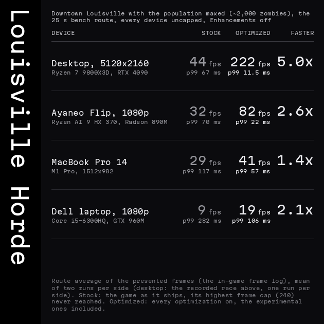

<h1 align="center">Project Zomboid without the stutter</h1>

<p align="center">
Class overrides for <b>Project Zomboid Build 42.21</b> (Windows, Linux, macOS): smoother frames, faster chunk loading,
a faster boot, and optional modern graphics. <code>projectzomboid.jar</code> is never modified; every change has a switch.
</p>

<p align="center">
<a href="https://steamcommunity.com/sharedfiles/filedetails/?id=3805285544"><b>Steam Workshop</b></a> ·
<a href="https://github.com/xD3I/PZ_Optimization/releases/latest"><b>Latest release</b></a> ·
<a href="https://discord.gg/W32aAnKpK"><b>Discord</b></a> ·
<a href="https://pzo.diegov.dev"><b>Live benchmark dashboard</b></a> ·
<a href="docs/guide/install.md"><b>Install guide</b></a>
</p>

<p align="center">
<a href="docs/guide/benchmarks.md"></a>
</p>
<p align="center">


</p>

<sub><i>Desktop (Ryzen 7 9800X3D, RTX 4090, 5120x2160, Linux), 120 km/h through Rosewood at 19:00, uncapped. Optimizations:
every optimization at its default. Enhancements: the experimental ones too and every Visuals option but remembered places,
HDR and upscaling. The stock car waits for chunks; its side shows where it passed the same spot.</i>
<a href="https://pzo.diegov.dev/d/pzopt-compare/compare?var-runs=wsf-stock-20261008-184816&var-runs=wsf-opt-20261008-185423&var-runs=wsf-max-20261008-185549&var-base=wsf-stock-20261008-184816">Runs</a></sub>

## Latest numbers

The daily re-measure of the newest release against the game as it ships, on the same desktop and routes
([every scene and machine](docs/guide/benchmarks.md)):

| Desktop, uncapped | Stock | Optimized | Faster | Optimized: GPU / game thread |
|---|---|---|---|---|
| 120 km/h drive | 107 fps · p99 21.5 ms | **663 fps** · p99 3.3 ms | 6.2x | 97 / 70 % |
| 120 km/h drive, thunderstorm + heavy fog | 53 fps · p99 58.8 ms | **504 fps** · p99 4.4 ms | 9.5x | 96 / 85 % |
| Spinning walk through Rosewood, thunderstorm + heavy fog | 31 fps · p99 95.6 ms | **293 fps** · p99 9.0 ms | 9.3x | 82 / 95 % |
| Horde shootout on the Riverside pier (150 zombies) | 144 fps · p99 15.3 ms | **333 fps** · p99 6.4 ms | 2.3x | 92 / 83 % |
| Downtown Louisville horde (~2,000 zombies) | 44 fps · p99 55.1 ms | **133 fps** · p99 16.9 ms | 3.0x | 40 / 96 % |

<sub><i>Ryzen 7 9800X3D, RTX 4090, 5120x2160, Linux, Build 42.21, max zoom (the shootout at zoom 1), Enhancements off.
Stock: the game as it ships; its 240 fps cap is never reached. Optimized: release a0cc7a4a (2026-10-15) at its defaults.
Mean of two runs a side; stock 2026-10-02/04, Louisville stock 2026-10-15 (one run). With the experimental optimizations
on too, Louisville runs at 222 fps (5.0x, below).</i>
Runs: <a href="https://pzo.diegov.dev/d/pzopt-compare/compare?var-runs=daily-stock4221-1-20261002-204027&var-runs=daily-1015-1-20261016-005020&var-base=daily-stock4221-1-20261002-204027">drive</a> ·
<a href="https://pzo.diegov.dev/d/pzopt-compare/compare?var-runs=dstorm-stock4221-1-20261002-204156&var-runs=dstorm-1015-1-20261016-005141&var-base=dstorm-stock4221-1-20261002-204156">storm drive</a> ·
<a href="https://pzo.diegov.dev/d/pzopt-compare/compare?var-runs=dspin-stock4221-2-20261002-205102&var-runs=dspin-1015-1-20261016-005301&var-base=dspin-stock4221-2-20261002-205102">storm walk</a> ·
<a href="https://pzo.diegov.dev/d/pzopt-compare/compare?var-runs=dhorde-stock4221-5-20261004-174358&var-runs=dhorde-1015-1-20261016-005530&var-base=dhorde-stock4221-5-20261004-174358">shootout</a> ·
<a href="https://pzo.diegov.dev/d/pzopt-compare/compare?var-runs=lourace-stock1-20261015-215851&var-runs=dlou-1015-1-20261016-005408&var-base=lourace-stock1-20261015-215851">Louisville</a></sub>

<a id="install"></a>

## Install (once, about two minutes)

> **Read before subscribing**
> - **Subscribing is not enough.** This replaces game classes; it needs the one-time install below.
> - **Mods: untested, unsupported.** Other mods may work alongside it; nobody checks them and problems with them are not fixed.
> - **Multiplayer: untested, unsupported.** It installs on your client only; joining a server may work, may not.
> - Something wrong? main menu > PZ OPTIMIZATION > "Stock game" preset, restart, then tell us on [Discord](https://discord.gg/W32aAnKpK).

<p align="center">


</p>

1. Subscribe to [PZ_Optimization on the Workshop](https://steamcommunity.com/sharedfiles/filedetails/?id=3805285544), let Steam download it.
2. Mods (main menu): enable **PZ_Optimization**; a window shows your install command.
3. **Copy the command**, paste it into PowerShell (Windows) or a terminal (Linux, macOS), Enter.
4. Quit the game; the installer copies the files when it has closed.
5. Start the game, disable the mod again. The main menu has a new **PZ OPTIMIZATION** item.

No window? Windows (PowerShell):

```powershell
irm https://github.com/xD3I/PZ_Optimization/releases/latest/download/install.ps1 | iex
```

Linux, macOS:

```sh
curl -fsSL https://github.com/xD3I/PZ_Optimization/releases/latest/download/install.sh | bash
```

**By hand**, no command: Steam: right-click the game, Manage > Browse local files. Go up to **steamapps**, then
`workshop\content\108600\3805285544\mods\PZ_Optimization\42\pzopt-classes`. Copy everything in it into the game folder
(where `projectzomboid.jar` is), skipping files that already exist.

Every method, checking that it loaded, building from source: **[Install guide](docs/guide/install.md)**.

## New! A built-in benchmark, one menu for everything

<p align="center">

</p>

## New! Voxel lighting

<p align="center">

</p>

Lamps and room lights traced through walls, windows and fences. Off by default: PZ OPTIMIZATION > Enhancements >
Lighting and shadows > Per-pixel lighting.

## Up to 5x faster in a Louisville horde

<p align="center">


</p>

<sub><i>Downtown Louisville, population maxed (~2,000 zombies), uncapped, Enhancements off. Stock: the game as it ships.
Optimized: every optimization on, the experimental ones included (2026-10-15). The race: desktop (Ryzen 7 9800X3D,
RTX 4090, 5120x2160, Linux), both sides recorded, each counter from its own run's frame log on the route clock.</i></sub>

## Features

<p align="center">


</p>

<sub><i><b>Fast boot and load</b>: desktop (Ryzen 7 9800X3D, RTX 4090, Crucial T705 NVMe, 5120x2160, Linux), launch to the
world on screen, caches warm, means of two runs per side: 17.6 → 7.8 s (boot 7.4 → 5.3 s, load 10.3 → 2.5 s).</i>
<a href="https://pzo.diegov.dev/d/pzopt-compare/compare?var-runs=boot-stock-20261006-205652&var-runs=boot-opt-20261006-205745&var-base=boot-stock-20261006-205652">Runs</a>
<i><b>Handheld efficiency</b>: Ayaneo Flip (Ryzen AI 9 HX 370, Radeon 890M, 1920x1080, Linux), thunderstorm, 120 fps cap:
34 → 78 fps, energy per frame 618 → 315 mJ (defaults + efficient cores).</i>
<a href="https://pzo.diegov.dev/d/pzopt-compare/compare?var-runs=flip-flipw120-storm-stock-20261006-190420&var-runs=flip-flipw120-storm-eff-20261006-190634&var-base=flip-flipw120-storm-stock-20261006-190420">Runs</a></sub>

<p align="center">


</p>

<sub><i><b>macOS on OpenGL 4.1</b>: MacBook Pro M1 Pro, a walk round a pond. Stock on Apple's OpenGL 2.1 (113 fps); ours on
OpenGL 4.1 with lighting, shadows, ambient occlusion, reflections and god rays on (115 fps).</i>
<a href="https://pzo.diegov.dev/d/pzopt-compare/compare?var-runs=mac-pondmac-stock-20261006-183159&var-runs=mac-pondmac-core-20261006-181155&var-base=mac-pondmac-stock-20261006-183159">Runs</a>
<i><b>Low-end hardware mode</b>: Dell laptop (Core i5-6300HQ 4 cores, GTX 960M, 1920x1080, Linux), 120 km/h highway drive:
the "Low-end hardware" preset + dynamic resolution held to 60 fps, 29 → 42 fps, p99 93 → 50 ms.</i>
<a href="https://pzo.diegov.dev/d/pzopt-compare/compare?var-runs=dell-delllow-stock-20261006-154553&var-runs=dell-delllow-dr-r2-20261006-162131&var-base=dell-delllow-stock-20261006-154553">Runs</a></sub>

Every feature with its before / after card (driving, hordes, weather, zoom, sound, the UI; per-pixel light, the real sky,
reflections, mirrors, car glass ...): **[Features](docs/guide/features.md)**.

## Against the other performance mods

<p align="center">


</p>

<sub><i>Desktop (Ryzen 7 9800X3D, RTX 4090, 5120x2160, Linux), Build 42.21, uncapped; every side of a route ran back to back
(2026-10-06/07). On the drive every other mod is within 3 % of stock; the two that gain in the horde do it by changing
the launcher's garbage collector and heap.</i>
<a href="https://pzo.diegov.dev/d/pzopt-compare/compare?var-runs=mx-stormfog120-stock-b1-20261007-001907&var-runs=mx-stormfog120-zedska-b-20261007-002037&var-runs=mx-stormfog120-optg1-b-20261007-002203&var-runs=mx-stormfog120-stock-b2-20261007-002323&var-base=mx-stormfog120-stock-b1-20261007-001907">Runs</a>
· <a href="docs/guide/benchmarks.md#against-the-other-performance-mods">The whole comparison</a></sub>

## Updates, uninstall

Updates arrive in the main menu (**PZ OPTIMIZATION > UPDATE**, one click; the item reads "UPDATE AVAILABLE" when one is offered). After a game update the next start removes a
build made for the old version by itself (or installs the matching one from the Workshop item) and starts the game again.

**To remove it:** main menu > PZ OPTIMIZATION > **Uninstall PZ Optimization**. Game does not start, or already
unsubscribed? Steam > Project Zomboid > Manage > **Browse local files**, double-click **Uninstall-PZ-Optimization.cmd**
(Linux, macOS: `bash uninstall-pz-optimization.bash` there), or paste
`irm https://github.com/xD3I/PZ_Optimization/releases/latest/download/uninstall.ps1 | iex` into PowerShell
(Linux, macOS: `curl -fsSL https://github.com/xD3I/PZ_Optimization/releases/latest/download/uninstall.sh | bash`).
Unsubscribing and "Verify integrity of game files" leave these files in the game folder; the uninstaller removes them.

## More

| Page | What is in it |
|---|---|
| [Install guide](docs/guide/install.md) | requirements, the four install methods, checking that it loaded, uninstall, the updater, game updates |
| [Benchmarks](docs/guide/benchmarks.md) | every scene on every machine (desktop, Windows, macOS, handheld, old laptop), the other mods, boot and load, frame pacing, latency, audio |
| [Features](docs/guide/features.md) | every optimization and enhancement with its before / after card |
| [Settings](docs/guide/settings.md) | the PZ OPTIMIZATION screen, frame caps, upscaling and DLSS, the performance overlay, `pzopt.properties` |
| [How it works](docs/guide/how-it-works.md) | what each optimization changes in the game, the install without touching the jar, what was measured and dropped |
| [Limitations and roadmap](docs/guide/limitations.md) | what is not tested, known issues, what is next |
| [Benchmark harness](docs/guide/harness.md) | the hands-off run rig, the run queue, Jev's verdicts, the repository layout |
| [Every run, in order](docs/results.md) | the run log since 2026-09-24 ([earlier runs](docs/archive/2026-09-24/)); [every edit to a game class](docs/override-edits.md) in prose |

<sub>Build 42.21, game revision <code>4a0e9546ec</code>. The overrides refuse to run against any other revision: they log one
line and the game behaves as stock. Project Zomboid is by The Indie Stone. This repository contains no game assets; the
edited class sources under <code>src/overrides/</code> are derived from the shipped jar for the sole purpose of these patches.</sub>
