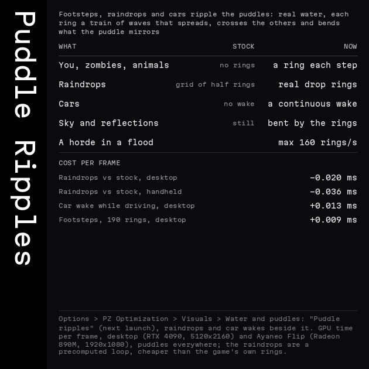

# Features

[Back to the README](../../README.md) · [Optimizations](#optimizations) · [Enhancements](#enhancements)

Every card as it was published on the [Workshop page](https://steamcommunity.com/sharedfiles/filedetails/?id=3805285544)
when the feature shipped, with its date: the numbers on a card are those of its day (the current ones are in
[Benchmarks](benchmarks.md)). The animated cards are GIFs and AVIFs, a few MB each.

## Optimizations

On by default unless the card says otherwise; each one has its own switch in Options > PZ Optimization > Performance
([Settings](settings.md)). How each works: [How it works](how-it-works.md).

<table>
<tr>
<td width="50%" valign="top"> <b>Smooth driving through town</b>: Rosewood at 120 km/h, 240 fps cap: 155 → 234 fps, 1 % low 29 → 120 fps, p99 35 → 8.4 ms; one prioritised bake budget per frame and even present pacing (2026-09-25).</td>
<td width="50%" valign="top"> <b>Fluid driving</b>: The car drawn between physics steps and the driving camera placed after the car moves: world judder 5.1 → 0.7 px on a 120 Hz handheld (2026-09-26).</td>
</tr>
<tr>
<td width="50%" valign="top"> <b>Driving through the trees</b>: Build 42.21 turned every tree near the car see-through and re-baked its chunk; the trees stay baked unless they reach the cutaway: the drive back to 500 fps (2026-10-03).</td>
<td width="50%" valign="top"> <b>Dynamic resolution</b>: The world renders smaller only while the GPU cannot hold the frame rate, upscaled with TAAU or FSR; off by default (2026-10-03).</td>
</tr>
<tr>
<td width="50%" valign="top"> <b>Zero lag UI</b>: Windows, menus, inventory and map redraw only what changed: the inventory 82 % cheaper, a click answered in the same frame (2026-09-30).</td>
<td width="50%" valign="top"> <b>Texture compression on the GPU</b>: With texture compression on, the GPU builds and encodes the textures instead of the driver on the render thread: the menu at 60 fps 4 s after launch (2026-09-25).</td>
</tr>
<tr>
<td width="50%" valign="top"> <b>Clear audio</b>: No more clipping on stereo under gunfire (6,161 → 0 clipped samples in 25 s), sound upkeep on the game thread 1.35 → 0.24 ms a frame (2026-09-24).</td>
<td width="50%" valign="top"> <b>Mac unbound</b>: macOS on OpenGL 4.1 core instead of Apple's 2.1: every Enhancement runs on the Mac (2026-10-01).</td>
</tr>
<tr>
<td width="50%" valign="top"> <b>Mod compatibility</b>: Java mods are read at launch; our setting for every game method a mod patches switches itself off, so the mod runs as its author wrote it (2026-10-01).</td>
<td width="50%" valign="top"> <b>Mod compatibility check</b>: A main menu page lists every Java mod and the settings it switched off; one button sets maximum compatibility (2026-10-02).</td>
</tr>
<tr>
<td width="50%" valign="top"> <b>Faster updates</b>: The in-game updater fetches only the files a release changed, in the background: Update now in 1-5 ms instead of 1.2-2.2 s, 57 KB instead of 59 MB (2026-09-26).</td>
<td width="50%" valign="top"> <b>Share settings</b>: Export every changed setting as text to the clipboard, import a friend's in one paste (2026-10-01).</td>
</tr>
<tr>
<td width="50%" valign="top"> <b>Settings in one place</b>: One PZ Optimization tab: home page with presets, categories, Simple / Advanced / Everything, one search, Fix a problem (2026-10-04).</td>
<td width="50%"></td>
</tr>
</table>

## Enhancements

Modern graphics built for the game's own renderer, each **off by default**: Options > PZ Optimization > Visuals. Most
cost a fraction of a millisecond a frame on the desktop
([`findings-enhancement-costs-2026-10-08.md`](../findings-enhancement-costs-2026-10-08.md)); the Visuals master switch
turns them all off at once.

<table>
<tr>
<td width="50%" valign="top"> <b>Entity shadows</b>: The player, zombies, animals and cars take the shadows of the walls, roofs and trees around them (2026-10-08).</td>
<td width="50%" valign="top"> <b>Entity shadows: what changed</b>: Stock against this release, and the cost per frame.</td>
</tr>
<tr>
<td width="50%" valign="top"> <b>Glass, screens and steel reflect</b>: Glass doors, store fronts, counters, cases, fridges, screens and steel reflect the scene in front (2026-10-09).</td>
<td width="50%" valign="top"> <b>Glass reflections: what changed</b>: Stock against this release, and the cost per frame.</td>
</tr>
<tr>
<td width="50%" valign="top"> <b>Puddle ripples</b>: Footsteps, raindrops and cars ring the puddles: real drop rings, a wake behind every car; the rain rings cheaper than the game's own (2026-10-11).</td>
<td width="50%" valign="top"> <b>Puddle ripples: what changed</b>: Stock against this release, and the cost per frame on the desktop and the handheld.</td>
</tr>
<tr>
<td width="50%" valign="top"> <b>Sun shadows</b>: Soft shadows of walls, trees, fences, people and cars, from the sun's real direction (2026-09-25).</td>
<td width="50%" valign="top"> <b>Sun, moon and clouds</b>: The sun and moon where they stand for the game's date and hour, moon shadows at night, drifting cloud shadows (2026-09-26).</td>
</tr>
<tr>
<td width="50%" valign="top"> <b>Detailed shadows</b>: Shadows drawn from the shape of what casts them: trees, people, animals, cars (2026-09-27).</td>
<td width="50%" valign="top"> <b>Per-pixel lighting</b>: Light falls smoothly across the world instead of tile by tile; torch and headlight beams drawn per pixel (2026-09-25).</td>
</tr>
<tr>
<td width="50%" valign="top"> <b>Light from the torch itself</b>: The beam starts at the torch in your hand, not at your feet (2026-10-03).</td>
<td width="50%" valign="top"> <b>Ambient occlusion</b>: Soft shading in corners, along wall bases and under furniture, baked with the chunk pictures: 0 standing, 4 µs a frame walking (2026-09-24).</td>
</tr>
<tr>
<td width="50%" valign="top"> <b>God rays</b>: Light shafts through windows and doorways, under trees and in fog (2026-09-27).</td>
<td width="50%" valign="top"> <b>Soft god rays</b>: Shafts with soft edges that blur the farther they reach from the window (2026-10-04).</td>
</tr>
<tr>
<td width="50%" valign="top"> <b>Reflections</b>: Rivers, lakes and puddles mirror the sky, the buildings, the lamps, cars and people (2026-09-26).</td>
<td width="50%" valign="top"> <b>Mirrors and windows</b>: Wall mirrors and window panes reflect the room and you (2026-10-03).</td>
</tr>
<tr>
<td width="50%" valign="top"> <b>Reflective props</b>: 438 props that are not windows or mirrors reflect too: glass doors, store fronts, counters, screens, gym mirrors (2026-10-09).</td>
<td width="50%" valign="top"> <b>Car glass</b>: Car windows reflect the sky and the scene and show the cabin behind them (2026-10-02).</td>
</tr>
<tr>
<td width="50%" valign="top"> <b>People in cars</b>: Stock never draws a seated character; the driver and passengers now sit behind the glass (2026-10-03).</td>
<td width="50%" valign="top"> <b>Darkness, memory, colour</b>: A soft darkness floor on seen squares, remembered places drawn grey and dim out of sight, colour grading by hour and weather (2026-09-26).</td>
</tr>
<tr>
<td width="50%" valign="top"> <b>Sharp sprites</b>: Crisp world art at any zoom instead of the game's blur: +15 to +30 % detail at no GPU cost (2026-09-26).</td>
<td width="50%" valign="top"> <b>Foliage sway</b>: Grass, bushes and trees move in the wind and bend as you walk through (2026-09-28).</td>
</tr>
<tr>
<td width="50%" valign="top"> <b>Wet blood</b>: Fresh blood is wet: pools catch the sun and the lamps and mirror what stands in them; floor blood is drawn faster too (2026-09-29).</td>
<td width="50%" valign="top"> <b>Relief</b>: Bricks, stones, planks and shingles catch the light at an angle (2026-09-30).</td>
</tr>
<tr>
<td width="50%" valign="top"> <b>Occluded zombie outlines</b>: Zombies your character sees keep a thin outline behind walls and roofs (2026-10-03).</td>
<td width="50%" valign="top"> <b>HDR output</b>: Real highlights on an HDR screen: lamps, fires, headlights and lightning brighter than the UI (Linux, macOS; 2026-09-24).</td>
</tr>
</table>
